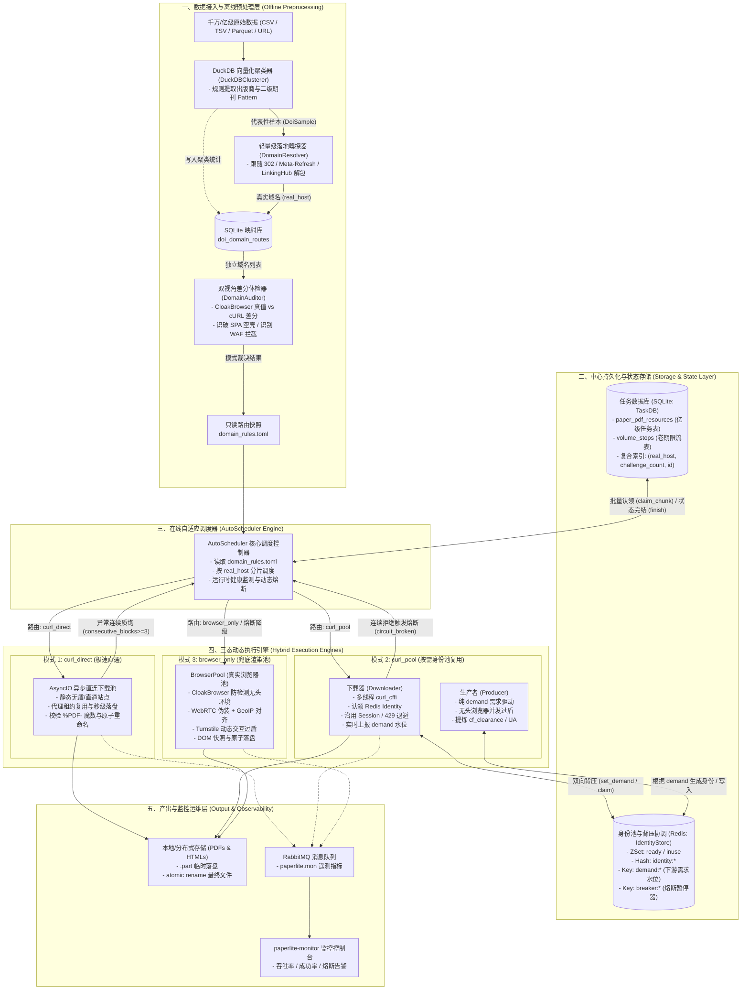
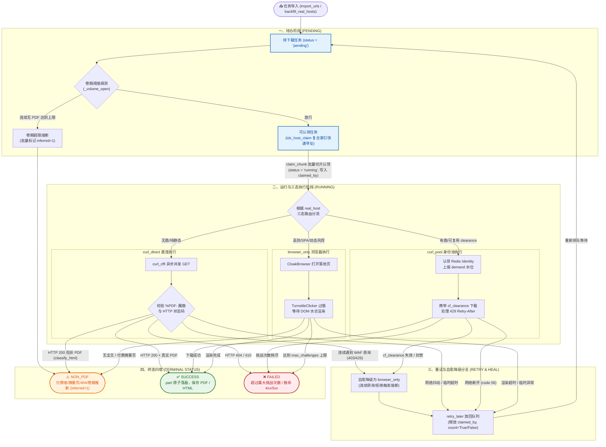
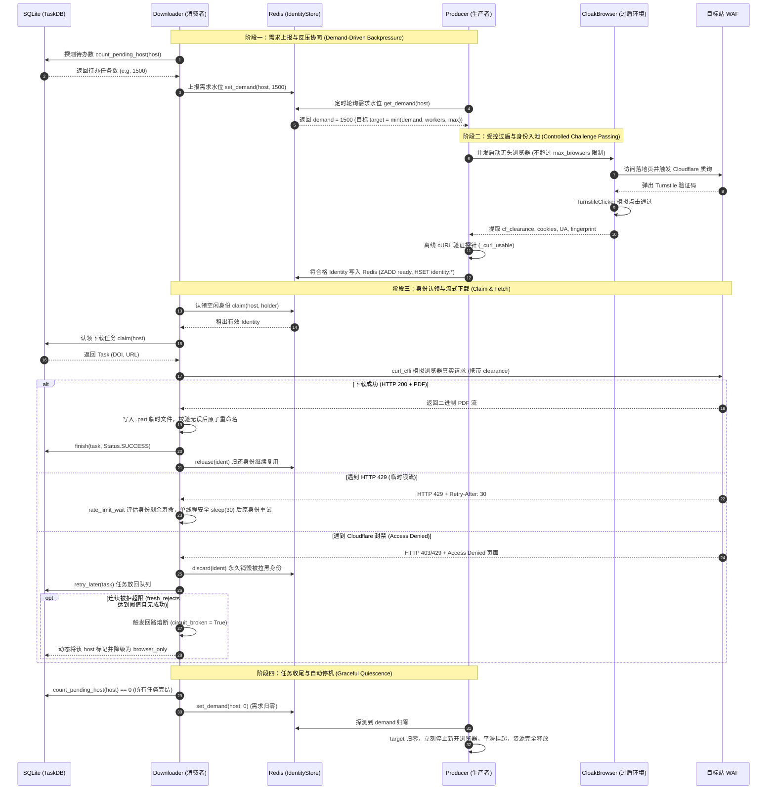

# PaperLite 系统架构与数据流转设计全景

本文档全面梳理 PaperLite 系统的软硬件拓扑、分层架构、核心子系统协作逻辑以及全生命周期数据流转模型。

---

## 1. 系统全景架构拓扑图

PaperLite 采用 **“预处理离线裁决 + 在线自适应混合三态调度 + 响应式背压生产”** 的三层复合架构体系：



---

## 2. 数据生命周期与状态机转换图

每条论文资源从导入、调度分发、多分支执行到最终落盘的全链路状态流转：



---

## 3. 三态混合调度与动态自愈熔断机制

PaperLite 创新的核心在于**兼顾极速吞吐与高防穿透**，调度器根据目标出版商的反爬强度自动选择最佳执行路径，并在运行时动态自愈：

| 模式 | 适用场景 | 关键机制与技术栈 | 资源消耗 | 故障与动态降级策略 |
| :--- | :--- | :--- | :--- | :--- |
| **`curl_direct`** | 无 WAF 防御、完全静态直出、公开获取的学术站点 | • `AsyncSession` 高并发协程池<br>• 单 IP 多任务并发分摊<br>• `%PDF-` 二进制魔数校验 | CPU/内存极低，带宽利用率 98%+ | 连续 3 次遇到 WAF 质询 (`consecutive_blocks >= 3`)：<br>立即断开当前批次，重置代理 IP，**动态自愈降级为 `browser_only`**。 |
| **`curl_pool`** | 有 Cloudflare 等 WAF 拦截，但 `cf_clearance` 可被脱机复用的站点 (如 ACM) | • **需求驱动反压机制** (`demand-driven`)<br>• 下游消费者通过 Redis 上报待办水位<br>• 生产者按需对冲启动无头浏览器过盾<br>• 沿用有效身份会话下载，遇 429 遵循 `Retry-After` | 动态弹性伸缩，无任务时 0 浏览器消耗 | 遇到硬性封禁 (`is_cf_denied`) 立即丢弃身份；<br>若 3 个新身份连续被拒 (`circuit_broken`)：<br>**动态自愈降级为 `browser_only`**。 |
| **`browser_only`** | 顶级高防站点 (如 ScienceDirect)、动态交互签名风控、或前端异步渲染 SPA 假空壳页 | • `CloakBrowser` 真实渲染管线<br>• WebRTC 防泄漏 + IP 地理位置对齐<br>• `TurnstileClicker` 自动检测与模拟点击<br>• DOM 结构监测与智能巡检 (`WindowInspector`) | 内存/GPU 消耗较高，单实例并发受限 | 严格限制并发数与标签页生命周期，任务异常时自动释放租约并平滑重启损坏的浏览器上下文。 |

---

## 4. 需求驱动型 Producer-Downloader 双向反压时序图

在 `curl_pool` 模式下，系统彻底摒弃了传统的“盲目预热身份”模式，转由下游实际消费需求驱动生产：



---

## 5. 核心模块与文件拓扑一览

```
PaperLite/src/paperlite/
├── cli.py                     # CLI 命令行总入口 (import, run, preprocess, resolve, audit, export, status)
├── config.py                  # TOML 配置解析器 (Paths, Limits, RunConfig, ProxySettings)
├── tasks.py                   # SQLite 核心任务库 (TaskDB: 复合索引认领、卷期限流、事务保证)
├── scheduler.py               # AutoScheduler 自动化调度引擎 (分流 direct, pool, browser 及自愈熔断)
├── consumer.py                # 消费者与下载执行器 (Downloader: 会话维护、PDF魔数校验、429退避)
├── producer.py                # 需求驱动型生产者 (Producer: 浏览器过盾、身份验收、背压控制)
├── store.py                   # Redis 分布式身份池 (IdentityStore: 租约续期、Lua 原子认领、需求水位)
├── browser_pool.py            # 纯浏览器池下载引擎 (BrowserPool: 协程池、标签页限速、DOM快照)
├── browser.py                 # 无头浏览器核心封装 (CloakBrowser 集成、反检测参数、过盾流程)
├── turnstile.py               # Cloudflare Turnstile 自动识别与模拟点击器
├── classify.py                # HTML 页面语义分类器 (精准区分 paywall, landing_page, not_found)
├── proxy.py                   # 代理 IP 轮换与健康体检提取器 (IpSource, Lease, Curl 探测探针)
├── cookies.py                 # CookieJar 序列化与跨组件还原工具
├── logutil.py                 # 结构化 JSON 日志格式化器
│
├── preprocess/                # 预处理离线裁决子系统
│   ├── cluster.py             # DuckDB 亿级 DOI 极速向量化聚类与样本抽样 (DuckDBClusterer)
│   ├── resolver.py            # 轻量级真实落地域名嗅探器 (DomainResolver, Meta-Refresh 解析)
│   ├── auditor.py             # 出版商反爬体检与模式裁决器 (DomainAuditor, DifferentialJudge)
│   ├── store.py               # 预处理 SQLite 中间库与 domain_rules.toml 导出器 (PreprocessStore)
│   ├── manager.py             # 预处理三阶段流水线总编排 (PreprocessManager)
│   └── models.py              # 数据传输对象定义 (DoiSample, ResolvedTarget, DomainAuditResult)
│
└── monitor/                   # 遥测监控与 Dashboard 子系统
    ├── reporter.py            # RabbitMQ 异步指标上报器 (线程隔离、无阻塞)
    ├── schema.py              # 遥测事件数据协议定义
    └── dashboard.py           # 命令行多域名实时监控面板 (paperlite-monitor)
```
